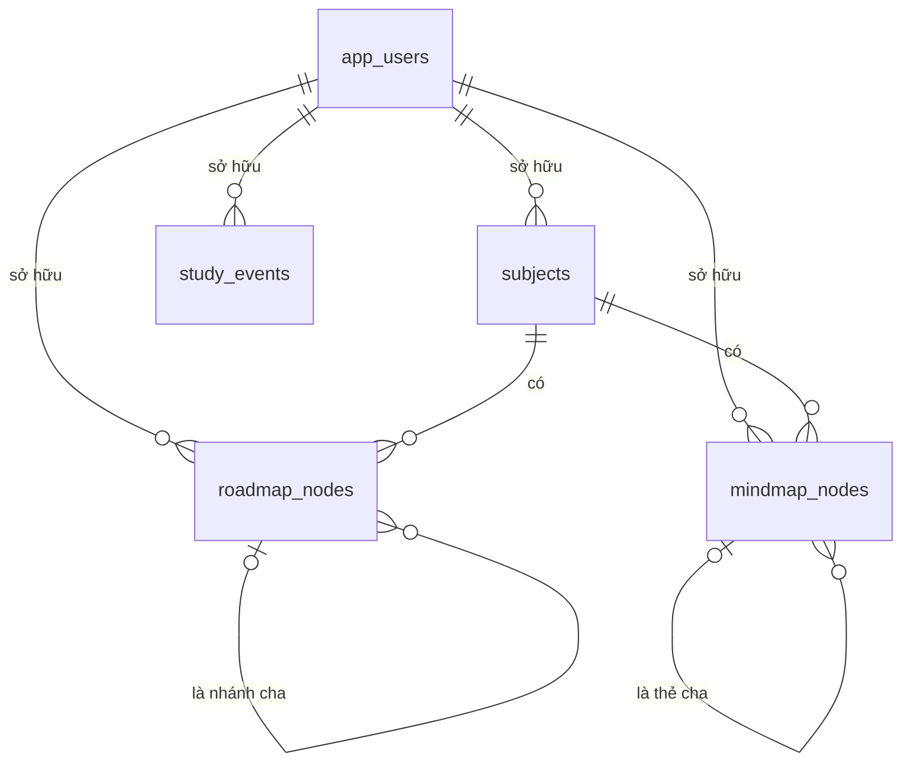

# Study Planner — Thiết kế cơ sở dữ liệu và mapping giao diện

Flutter đọc và ghi dữ liệu học tập qua Drift/SQLite. Spring Boot cung cấp API đăng nhập và đồng bộ với PostgreSQL theo tài khoản. Khi người dùng bấm **Đồng bộ dữ liệu**, Flutter gửi các thay đổi cục bộ và cập nhật SQLite từ dữ liệu server.

## 1. Thiết kế cơ sở dữ liệu

Flutter đọc và ghi SQLite để giao diện hoạt động offline. Android và Windows lưu trên thiết bị. Web dùng SQLite WASM trong vùng lưu trữ của trình duyệt. Spring Boot quản lý tài khoản và dữ liệu đồng bộ trên PostgreSQL. Hai bên dùng cùng UUID để nhận diện một bản ghi học tập. [Schema Drift](../frontend/lib/data/app_database.dart) · [Migration PostgreSQL V1](../backend/src/main/resources/db/migration/V1__create_study_planner_tables.sql) · [Migration PostgreSQL V2](../backend/src/main/resources/db/migration/V2__mindmap_deletion.sql) · [Migration PostgreSQL V3](../backend/src/main/resources/db/migration/V3__study_event_deletion.sql)

**Phạm vi** gồm 6 bảng SQLite với 31 cột và 5 bảng nghiệp vụ PostgreSQL với 42 cột. Drift nâng lên schema v3 khi mở cơ sở dữ liệu. Flyway áp dụng migration V3 khi backend khởi động và ghi lịch sử vào `flyway_schema_history`.

### Quan hệ

Sơ đồ thể hiện các khóa ngoại của PostgreSQL. Tất cả dùng `ON DELETE CASCADE` khi xóa vật lý. SQLite liên kết môn và node cha bằng ID trong mã ứng dụng. Mỗi lịch học thuộc tài khoản và tồn tại độc lập với môn học. `mindmap_deletions` và `study_event_deletions` lưu các yêu cầu xóa chờ đồng bộ trên thiết bị.

### Các bảng và cột

Các cột có ràng buộc `NOT NULL` trừ khi ô kiểu dữ liệu ghi `NULL`. `DEFAULT` là mặc định của schema. `—` nghĩa là cột nằm ở phía còn lại. **PK** là khóa chính, **FK** là khóa ngoại.

#### `app_users` — Tài khoản

| Cột | SQLite | PostgreSQL | Ý nghĩa |
| --- | --- | --- | --- |
| `id` | — | `UUID PK` | Backend tạo UUID khi đăng ký. |
| `email` | — | `VARCHAR(254) UNIQUE` | Email đăng nhập, chuẩn hóa thành chữ thường. |
| `password_hash` | — | `VARCHAR(100)` | Mật khẩu đã băm bằng BCrypt. |
| `created_at` | — | `TIMESTAMPTZ DEFAULT now()` | Thời điểm tạo tài khoản. |

#### `subjects` — Môn học

| Cột | SQLite | PostgreSQL | Ý nghĩa |
| --- | --- | --- | --- |
| `id` | `TEXT PK` | `UUID PK` | ID môn do Flutter tạo. |
| `user_id` | — | `UUID FK` | Chủ sở hữu, trỏ tới `app_users.id`. |
| `name` | `TEXT` | `VARCHAR(120)` | Tên môn. Drift kiểm tra độ dài 1–120 ký tự. |
| `color` | `TEXT DEFAULT '#5685F7'` | `VARCHAR(20) DEFAULT '#5685F7'` | Mã màu của môn. |
| `created_at` | — | `TIMESTAMPTZ DEFAULT now()` | Thời điểm tạo trên server. |
| `updated_at` | — | `TIMESTAMPTZ DEFAULT now()` | Lần cập nhật gần nhất, API trả về `updatedAt`. |
| `is_synced` | `INTEGER DEFAULT 0` | — | Cờ đồng bộ cục bộ. |

Chỉ mục PostgreSQL `idx_subjects_user_updated (user_id, updated_at)`.

#### `study_events` — Lịch học

| Cột | SQLite | PostgreSQL | Ý nghĩa |
| --- | --- | --- | --- |
| `id` | `TEXT PK` | `UUID PK` | ID lịch học. |
| `user_id` | — | `UUID FK` | Chủ sở hữu, trỏ tới `app_users.id`. |
| `title` | `TEXT` | `VARCHAR(160)` | Tên lịch. Drift kiểm tra độ dài 1–160 ký tự. |
| `details` | `TEXT DEFAULT ''` | `TEXT DEFAULT ''` | Ghi chú. |
| `starts_at` | `INTEGER` | `TIMESTAMPTZ` | Giờ bắt đầu. |
| `ends_at` | `INTEGER` | `TIMESTAMPTZ` | Giờ kết thúc, phải sau giờ bắt đầu. |
| `reminder_at` | `INTEGER NULL` | `TIMESTAMPTZ NULL` | Giờ nhắc nếu bật. Mặc định nhắc trước 10 phút. Khi đổi giờ bắt đầu, ứng dụng giữ khoảng thời gian báo trước của lịch cũ. |
| `created_at` | — | `TIMESTAMPTZ DEFAULT now()` | Thời điểm tạo trên server. |
| `updated_at` | — | `TIMESTAMPTZ DEFAULT now()` | Lần cập nhật gần nhất trên server. |
| `is_synced` | `INTEGER DEFAULT 0` | — | Cờ đồng bộ cục bộ. |
| `is_deleted` | — | `BOOLEAN DEFAULT FALSE` | Cờ xóa mềm, ánh xạ sang `deleted` trong JSON. Lịch có sẵn được giữ với giá trị `FALSE` sau migration. |

PostgreSQL kiểm tra `ends_at > starts_at` qua `ck_study_event_duration`. Chỉ mục `idx_events_user_start (user_id, starts_at)`.

#### `study_event_deletions` — Lịch đã xóa chờ đồng bộ

| Cột | SQLite | PostgreSQL | Ý nghĩa |
| --- | --- | --- | --- |
| `id` | `TEXT PK` | — | UUID của lịch cần gửi yêu cầu xóa. |

Flutter ghi ID vào hàng đợi và xóa lịch khỏi `study_events` trong cùng một giao dịch. Khi server xác nhận `DELETE /api/events/{id}`, Flutter bỏ ID khỏi hàng đợi. Thiết bị khác nhận `deleted: true` từ `GET /api/events?includeDeleted=true` rồi xóa bản sao cục bộ.

#### `roadmap_nodes` — Nhánh lộ trình

| Cột | SQLite | PostgreSQL | Ý nghĩa |
| --- | --- | --- | --- |
| `id` | `TEXT PK` | `UUID PK` | ID nhánh. |
| `user_id` | — | `UUID FK` | Chủ sở hữu, trỏ tới `app_users.id`. |
| `subject_id` | `TEXT` | `UUID FK` | Môn của nhánh, trỏ tới `subjects.id`. |
| `parent_id` | `TEXT NULL` | `UUID FK NULL` | Nhánh cha, trỏ tới `roadmap_nodes.id`. Nhánh gốc có giá trị `NULL`. |
| `title` | `TEXT` | `VARCHAR(160)` | Tên chủ đề. Drift kiểm tra độ dài 1–160 ký tự. |
| `note` | `TEXT DEFAULT ''` | `TEXT DEFAULT ''` | Ghi chú học tập. |
| `status` | `TEXT DEFAULT 'planned'` | `VARCHAR(20) DEFAULT 'planned'` | Trạng thái `planned`, `in_progress` hoặc `done`. |
| `sort_order` | `INTEGER DEFAULT 0` | `INTEGER DEFAULT 0` | Thứ tự hiển thị nhánh. |
| `due_at` | `INTEGER NULL` | `TIMESTAMPTZ NULL` | Hạn học nếu được đặt. Giao diện tạo nhánh với `NULL`. |
| `created_at` | — | `TIMESTAMPTZ DEFAULT now()` | Thời điểm tạo trên server. |
| `updated_at` | — | `TIMESTAMPTZ DEFAULT now()` | Lần cập nhật gần nhất trên server. |
| `is_synced` | `INTEGER DEFAULT 0` | — | Cờ đồng bộ cục bộ. |

PostgreSQL kiểm tra trạng thái qua `ck_roadmap_status`. Chỉ mục `idx_roadmap_subject_order (subject_id, parent_id, sort_order)`.

#### `mindmap_nodes` — Thẻ bản đồ tư duy

| Cột | SQLite | PostgreSQL | Ý nghĩa |
| --- | --- | --- | --- |
| `id` | `TEXT PK` | `UUID PK` | ID thẻ. |
| `user_id` | — | `UUID FK` | Chủ sở hữu, trỏ tới `app_users.id`. |
| `subject_id` | `TEXT` | `UUID FK` | Môn của thẻ, trỏ tới `subjects.id`. |
| `parent_id` | `TEXT NULL` | `UUID FK NULL` | Thẻ cha, trỏ tới `mindmap_nodes.id`. Ý chính có giá trị `NULL`. |
| `title` | `TEXT` | `VARCHAR(160)` | Tiêu đề thẻ. Drift kiểm tra độ dài 1–160 ký tự. |
| `content` | `TEXT DEFAULT ''` | `TEXT DEFAULT ''` | Nội dung ghi chú. |
| `x` ↔ `position_x` | `REAL DEFAULT 100` | `DOUBLE PRECISION DEFAULT 0` | Tọa độ ngang. JSON dùng `x`. |
| `y` ↔ `position_y` | `REAL DEFAULT 100` | `DOUBLE PRECISION DEFAULT 0` | Tọa độ dọc. JSON dùng `y`. |
| `created_at` | — | `TIMESTAMPTZ DEFAULT now()` | Thời điểm tạo trên server. |
| `updated_at` | — | `TIMESTAMPTZ DEFAULT now()` | Lần cập nhật gần nhất trên server. |
| `is_synced` | `INTEGER DEFAULT 0` | — | Cờ đồng bộ cục bộ. |
| `is_deleted` | — | `BOOLEAN DEFAULT FALSE` | Cờ xóa mềm. API bỏ qua các thẻ đã xóa khi trả danh sách. |

Chỉ mục PostgreSQL `idx_mindmap_subject (subject_id)`. Giao diện tính tọa độ khi tạo thẻ mới và lưu lại khi kéo thẻ.

#### `mindmap_deletions` — Lệnh xóa chờ đồng bộ

| Cột | SQLite | PostgreSQL | Ý nghĩa |
| --- | --- | --- | --- |
| `id` | `TEXT PK` | — | UUID của thẻ đã xóa. |
| `subject_id` | `TEXT` | — | ID môn cần gửi kèm yêu cầu xóa. |

Flutter xóa dòng trong `mindmap_nodes` và lưu lệnh vào hàng đợi trong cùng một giao dịch. Server đánh dấu xóa mềm. Cả hai phía đưa nhánh con trực tiếp về gốc. Flutter dọn lệnh sau khi server xác nhận.

### Quy ước lưu trữ

- **Định danh và sở hữu.** Flutter sinh UUID v4 cho môn, lịch, nhánh và thẻ. Spring Boot xác định `user_id` từ tài khoản đã xác thực. SQLite dùng chung trong một bản cài hoặc origin Web, kể cả khi đổi tài khoản.
- **Thời gian.** SQLite lưu số mili giây từ Unix epoch. PostgreSQL lưu mốc thời gian bằng `TIMESTAMPTZ`. API dùng ISO 8601 và Flutter hiển thị theo múi giờ thiết bị. JPA thiết lập `created_at` và cập nhật `updated_at` khi ghi thay đổi.
- **Đồng bộ.** `is_synced` lưu `0` hoặc `1` trong SQLite. Bản ghi chờ gửi có giá trị `0`. Bản ghi đã gửi thành công hoặc tải từ server có giá trị `1`.
- **Dữ liệu ngoài bảng.** JWT và email phiên nằm trong `FlutterSecureStorage` qua `SessionStore`. Khi lưu phiên lỗi, app giữ phiên trong bộ nhớ cho lần chạy hiện tại. Bộ đếm tập trung cũng dùng bộ nhớ. Thông báo dựa trên giờ nhắc và do hệ điều hành lập lịch.

[Lưu phiên](../frontend/lib/data/session_store.dart) · [Dấu thời gian JPA](../backend/src/main/java/com/duy/studyplanner/api/common/OwnedEntity.java) · [Đồng bộ](../frontend/lib/data/sync_service.dart)

## 2. Đặc tả API

Flutter gọi `http://localhost:8080/api` theo mặc định. Xem [đặc tả REST API](api.md) để tra đường dẫn đầy đủ, trường request và response, xác thực JWT, mã lỗi và ví dụ.

## 3. Mapping thông tin với giao diện

| Màn hình hoặc thao tác | Nguồn và trường dữ liệu | Hành vi trên giao diện và API |
| --- | --- | --- |
| **Đăng nhập / Đăng ký** | Email và mật khẩu → `email`, `password`. Phản hồi → `result.token`, `result.email`. | Gọi API Auth khi gửi form. Khi nhận token hợp lệ, app mở màn hình chính và hiển thị email ở menu tài khoản. **Tiếp tục ở chế độ offline** mở các màn hình dùng dữ liệu cục bộ. |
| **Tổng quan** | `study_events.title`, `starts_at`, `ends_at` và số dòng `subjects`. | **Lịch sắp tới** đếm lịch có `ends_at >= thời điểm hiện tại`. **Lịch gần nhất** hiện tối đa 4 lịch trong nhóm này, theo giờ bắt đầu. Số môn đọc từ Drift. |
| **Lịch học** | **Tên lịch** → `title`. **Ghi chú** → `details`. **Bắt đầu/Kết thúc** → `starts_at/ends_at` ↔ `startsAt/endsAt`. **Nhắc giờ học** → `reminder_at` ↔ `reminderAt`. | Bảng hiển thị các buổi giao với ngày đang chọn theo giờ thiết bị. Thêm hoặc sửa ghi vào SQLite rồi gửi bằng `PUT /api/events/{id}` khi đồng bộ. Xóa bỏ dòng khỏi bảng và đưa ID vào hàng đợi gửi `DELETE`. |
| **Lộ trình → Môn học** | **Tên môn học** → `subjects.name`. `id` định danh môn và `color` được gán `#5685F7` khi tạo từ giao diện. | Lưu local rồi mở cây của môn vừa tạo. Danh sách môn sắp theo tên. Đồng bộ qua `PUT /api/subjects/{id}` và `GET /api/subjects`. |
| **Lộ trình → Chi tiết môn** | Môn đang mở → `subject_id` ↔ `subjectId`. **Tên chủ đề** → `title`. **Nhánh cha** → `parent_id` ↔ `parentId`. **Ghi chú** → `note`. **Trạng thái** → `status`. | Nhánh mới có `planned` và `due_at = NULL`. Giao diện dùng `sort_order` để sắp xếp, nhóm theo cha. Mở nhánh để sửa ghi chú và trạng thái. Tiến độ bằng số nhánh `done` chia tổng số nhánh. Đồng bộ qua API roadmap. |
| **Mindmap trên Windows và Web rộng** | Môn → `subject_id`. Ý chính hoặc nhánh con → `parent_id`. **Tiêu đề** → `title`. **Nội dung ghi chú** → `content`. Vị trí thẻ → `x`, `y`. | Bấm thẻ để chọn. **Thêm ý chính**, **Thêm nhánh**, **Chi tiết / Sửa**, **Nối vào…**, **Gỡ kết nối** và **Xóa thẻ** là các thao tác riêng. Kéo thẻ để lưu vị trí. `parent_id` xác định đường nối. Đồng bộ qua các API mindmap. |
| **Mindmap trên điện thoại hoặc Web hẹp** | `subject_id`, `title`, `content`, tiêu đề node cha tra qua `parent_id`. | Danh sách chỉ xem theo môn. **Chỉnh sửa trên máy tính** hướng dẫn mở Web editor và đồng bộ giữa hai thiết bị. |
| **Tập trung** | Thời lượng 25, 45 hoặc 60 phút, số giây còn lại và trạng thái chạy nằm trong bộ nhớ màn hình. | Bắt đầu, tạm dừng hoặc đặt lại bằng bộ đếm Flutter. Thông báo kết thúc được đặt cục bộ trên nền tảng hỗ trợ. Chức năng này chạy độc lập với Drift và API. |

Trạng thái lộ trình hiển thị thành **Chưa bắt đầu** (`planned`), **Đang học** (`in_progress`) và **Hoàn thành** (`done`). Trình chỉnh sửa mindmap mở trên Windows hoặc Web có vùng hiển thị từ 760 px. Lịch học có nhắc được đặt qua hệ thống thông báo trên Android và Windows khi mốc nhắc còn ở tương lai. Trên Web, biểu tượng chuông cho biết lịch có bật nhắc.

[Mã nguồn các màn hình Flutter](../frontend/lib/screens/) · [Dịch vụ thông báo](../frontend/lib/data/notification_service.dart)

### Kết quả đăng ký và đăng nhập trên giao diện

| Kết quả | Hành vi của app |
| --- | --- |
| Server trả token và email, lưu phiên thành công | Mở màn hình chính. Khi mở lại app, phiên đã lưu được khôi phục. |
| Server trả token và email, bộ nhớ bảo mật báo lỗi khi lưu | Mở màn hình chính với phiên trong bộ nhớ. Người dùng có thể đồng bộ trong lần chạy này và cần đăng nhập lại khi mở lại app. |
| Email đã tồn tại, HTTP `409` | Hiển thị **Email đã được đăng ký. Hãy chọn Đăng nhập.** |
| Sai email hoặc mật khẩu, HTTP `401` | Hiển thị **Email hoặc mật khẩu chưa đúng.** |
| Client không kết nối được API | Hiển thị thông báo kèm URL đang dùng từ `API_BASE_URL`. |
| Phản hồi thiếu token hợp lệ hoặc email | Hiển thị **Máy chủ không trả về phiên đăng nhập hợp lệ.** |

Đăng ký một lần trên backend dùng chung. Trên thiết bị khác, chọn **Đăng nhập** với cùng email và bấm **Đồng bộ dữ liệu** để tải dữ liệu. [Xử lý form xác thực](../frontend/lib/screens/login_screen.dart) · [Quản lý phiên trong Flutter](../frontend/lib/study_app.dart)

## 4. Luồng đồng bộ và đối chiếu trên giao diện

1. Tạo lịch, môn hoặc node từ giao diện. Flutter lưu SQLite với `is_synced = 0` và cập nhật màn hình từ stream Drift.
2. Khi đã đăng nhập, bấm **Đồng bộ dữ liệu**. Client lần lượt gửi rồi tải **môn → lịch → lộ trình → mindmap**. Khi gửi cây, client xử lý node cha đang chờ gửi trước node con. Client gửi lệnh xóa mindmap trước khi gửi các cập nhật của mindmap.
3. Các bản ghi đã gửi thành công được đánh dấu đồng bộ. Dữ liệu tải về được ghi theo cùng UUID. Với lịch học và lộ trình, client giữ bản sửa cục bộ đang chờ gửi và kiểm tra bản ghi có đổi trong lúc gửi trước khi đánh dấu đã đồng bộ. Với lịch học, client cũng bỏ qua lịch đang chờ xóa và áp dụng cờ xóa nhận từ server.
4. Trên thiết bị hoặc hồ sơ trình duyệt khác, đăng nhập cùng tài khoản rồi bấm đồng bộ. Đối chiếu tên và giờ trong **Lịch học**, tiến độ trong **Lộ trình**, tiêu đề và nội dung trong **Mindmap**.

Nếu đồng bộ lỗi giữa chừng, các bước đã ghi thành công vẫn có hiệu lực. Nút đồng bộ hiển thị lỗi và cho phép thử lại. Hai lần sửa cùng một lịch đang hoạt động áp dụng theo thứ tự server ghi thành công. Sau khi server đánh dấu xóa, các lần gửi sửa lịch đó nhận HTTP `410` với mã `01211`.

[Thứ tự và logic đồng bộ](../frontend/lib/data/sync_service.dart) · [Nút đồng bộ](../frontend/lib/screens/app_shell.dart) · [Hướng dẫn chạy ứng dụng](../README.md)
